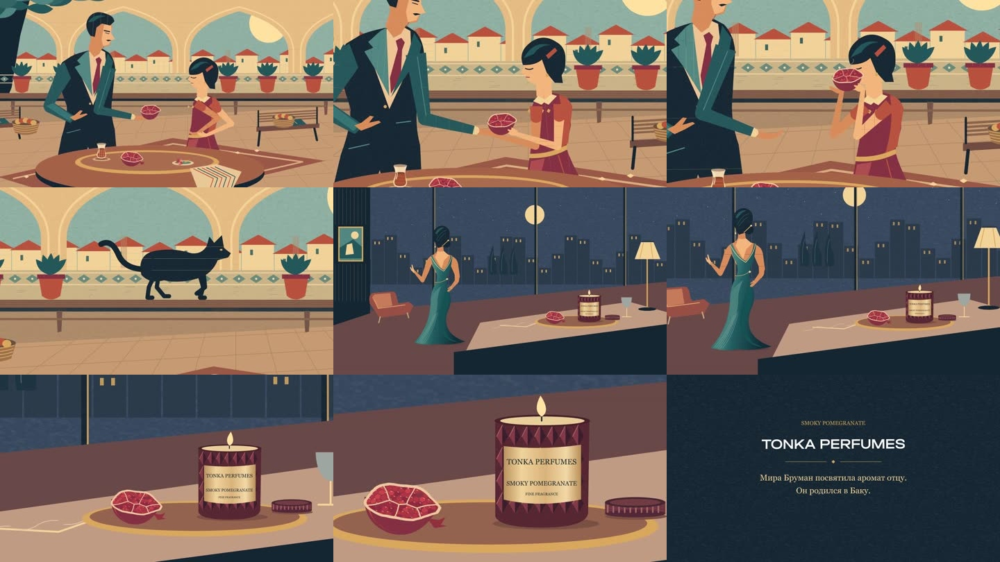

# Smoky Pomegranate - «Пока горит окно»

**Ролик для TONKA PERFUMES, подготовленный для MGIMO AI Challenge 2026 в номинации «ИИ-видео». Авторы и руководители проекта - Basil и PERZIVAL1967.**

- [Смотреть финальный ролик v10](Smoky_Pomegranate_Art_Deco_v10.mp4) · MP4, 35 секунд, 1920 × 1080, 24 кадра/с, оригинальная музыка. Оригинальное качество - по ссылке в форме отправки (Google Диск). Предыдущая версия: [v05](Smoky_Pomegranate_Art_Deco_Couture_v05.mp4).
- [Описание процесса создания (PDF, на русском)](Smoky_Pomegranate_Process_RU.pdf) · 9 страниц: пять подходов, нейросети и сервисы, промпты по сценам, единый стиль, монтаж, права на музыку и звук.
- [История создания и архив промптов](Smoky_Pomegranate_Production_History.pdf) · PDF, 41 страница, на английском. Разбор обсуждений команды, рабочих версий, проб и финального монтажа.
- [Краткое описание процесса](Process_Smoky_Pomegranate.docx) · DOCX на русском.

## Сюжет

Во дворе Баку отец протягивает дочери половину граната. Спустя годы аромат свечи возвращает её к этому воспоминанию. Чёрный кот проходит перед камерой и на мгновение закрывает кадр. Когда он уходит, мы видим взрослую героиню у окна.

## Как сделали ролик

| Этап | Работа |
|---|---|
| Сценарий и раскадровка | Команда обсудила несколько вариантов истории и выбрала короткую версию «Пока горит окно». |
| Превиз в Blender | Проверили расположение персонажей, передачу граната, маршрут кота и положение камеры на склейке. |
| Генеративные пробы | В Lovart с Seedance 2.0 пробовали отдельные сцены. В Dreamina проверяли цельный 30-секундный ролик по Blender-превизу. |
| Нейросеть поверх превиза | Пробовали перерисовать Blender-превиз в фотореализм (Seedance, Dreamina). Модель приняла условные фигуры за деревянные, стол вышел слишком высоким, кот - искажённым. |
| Анимация ар-деко | Собрали рисованные декорации, персонажей, свечу и переход в Python. Проверили монтаж и экспортировали 35-секундный MP4 (v05-v06). |
| Финальная доработка (v10) | Оригинальная джазовая музыка 1920-х и звуковой дизайн старого Баку, синтезированные программно; золотая рамка ар-деко; 1080p; детали окружения, закреплённые за слоями анимации; роза и шафран как ноты аромата. Скрипты - в [art-deco-finish](art-deco-finish/). |

## Ключевые решения

1. **Гранат передаётся из рук в руки.** Отец отпускает плод после того, как дочь подхватывает его обеими руками. Пауза перед вдохом даёт жесту время прочитаться.
2. **Кот скрывает склейку.** Камера подходит к его боку до полного перекрытия кадра. Движение силуэта продолжается после смены сцены.
3. **Свеча нарисована по референсу TONKA 220 мл.** Бордовое гранёное стекло, золотистая этикетка и отдельная ребристая крышка сохранены в стилистике ар-деко.
4. **Финальные пять секунд отведены фирменному знаку.** Название аромата и посвящение появляются после крупного плана свечи.

## Рабочие материалы

- [Промпты и кадры проб Seedance 2.0](seedance-tests/README.md)
- [Референсы и две пробы Dreamina](PRODUCTION-HANDOFF.md)

## Команда

**Авторы ролика и руководители проекта - Basil и PERZIVAL1967.** Они вместе разработали замысел, обсуждали сюжет и определяли творческое направление. Codex и Claude Code помогали воплотить их решения.

| Участник | Вклад |
|---|---|
| **Basil** ([@vdutka](https://github.com/vdutka), соавтор) | Вместе с PERZIVAL1967 развивал сюжет и определял, как рассказать его на экране. Предложил переход с чёрным котом, ставил задачи Codex и направлял работу над финальным роликом. |
| **PERZIVAL1967** (соавтор) | Вместе с Basil развивал замысел, обсуждал варианты сценария и участвовал в творческих решениях. Курировал работу Claude Code и передал команде фирменные материалы TONKA. |
| **Codex** (ИИ-агент, OpenAI) | Под руководством Basil выполнил основную техническую работу над финальным роликом. Подготовил раскадровку и превиз в Blender, провёл пробы в Lovart с Seedance 2.0, реализовал векторную анимацию в Python, собрал и экспортировал ролик. |
| **Claude Code** (ИИ-агент, Anthropic) | Под руководством PERZIVAL1967 подготовил ранние версии сценария, покадровый план, промпты для Seedance и инструкцию по подаче работы. В финальной версии v10 сочинил и синтезировал оригинальную музыку и звук, добавил золотую рамку, детали окружения и сделал сборку в 1080p. |

## Музыка, звук и права

Музыка и все шумы финальной версии v10 синтезированы программно с нуля ([score.py](art-deco-finish/score.py)): без сэмплов и чужих записей, это оригинальная работа команды. Голоса в финальной версии нет. Логотип и свеча TONKA взяты из материалов партнёра конкурса.
