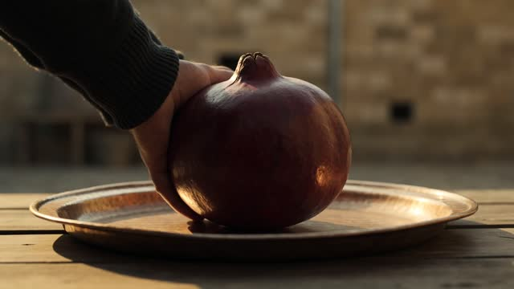
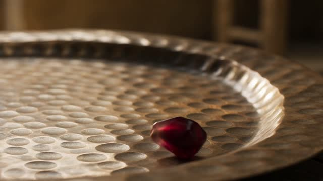
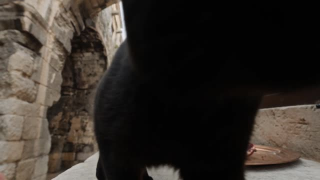

# Материалы для PDF по ролику Tonka
Черновой прогон Lovart. Ниже сохранены фактически отправленные запросы к модели Seedance 2.0. Иллюстрации взяты из полученных клипов. При сборке PDF сверить каждый кадр с окончательным монтажом.

## Сцена 01

Photorealistic restrained 35 mm live-action short film from a child-height perspective. Period-neutral old Baku domestic limestone courtyard and adjoining kitchen. Same fictional father wearing charcoal wool, seen only by hands, sleeves or back; same fictional girl in muted ochre; same short-haired entirely black cat; same round worn copper tray and large naturally split dark wine-red pomegranate. Natural exposure, soft film grain, believable tactile motion. Follow the timed storyboard precisely, with hard cuts at shot boundaries and stable compositions. Generate quiet location sound and specified physical sounds only. No narration, music, text, titles, subtitles, or logos over footage. No modern skyline or landmarks. Do not copy people or cats from architectural reference photographs. All footage must be newly generated. Warm late-afternoon gold, dusty ochre, copper, and sandy limestone. [00-05s] Тяжесть плода. Деталь, 85 мм; стол на нижней трети, гранат в центре. Первые 2 с папины руки опускают плод; затем пальцы отпускают его. Поднос слегка отзывается, плод остаётся неподвижен. Статика у края стола. Косой тёплый свет слева выявляет медь и кожуру. Sound cue: Глухой удар о медь, двор вдали. Склейка после остановки рук.
[05-09s] Трещина. Макро, 100 мм; основание граната по диагонали. На уже существующей трещине собирается капля. На последней секунде она тяжелеет, но ещё держится. Очень медленное приближение. Фон мягкий, зерно плёнки едва заметно. Sound cue: Тихий шорох кожицы. Без музыки; прямая склейка к рукам.
[09-15s] Папа раскрывает гранат. Крупный; две руки по сторонам, трещина между ними. Большие пальцы входят в трещину. Две половины расходятся в стороны; сок падает на поднос. Не показывать невозможное мгновенное раскрытие. Статика, 50 мм, чуть выше стола. Тёмный рукав неизменен. Sound cue: Влажный хруст. ЗК начинается на 11 с: «Папа умел выбирать гранаты».
 Ignore voiceover cues above during generation; voiceover is added in the edit.

## Сцена 02

Photorealistic restrained 35 mm live-action short film from a child-height perspective. Period-neutral old Baku domestic limestone courtyard and adjoining kitchen. Same fictional father wearing charcoal wool, seen only by hands, sleeves or back; same fictional girl in muted ochre; same short-haired entirely black cat; same round worn copper tray and large naturally split dark wine-red pomegranate. Natural exposure, soft film grain, believable tactile motion. Follow the timed storyboard precisely, with hard cuts at shot boundaries and stable compositions. Generate quiet location sound and specified physical sounds only. No narration, music, text, titles, subtitles, or logos over footage. No modern skyline or landmarks. Do not copy people or cats from architectural reference photographs. All footage must be newly generated. Warm late-afternoon gold, dusty ochre, copper, and sandy limestone. [00-05s] Первое зерно. Деталь; зерно в правой нижней трети. Зерно катится по меди. Детский палец входит слева, останавливает его. Красный след остаётся на пальце. Статика, 85 мм. Руки отца уже вне кадра. Sound cue: Продолжение ЗК: «Этот уже не помещался в своей кожуре». Затихание голоса до 20 с.
[05-10s] Лучшая половина. ИНТ. КУХНЯ. Средний на уровне ребёнка; папа слева, дочь справа. Тот же поднос на кухонном столе. Папа разворачивает более полную половину к дочери и подвигает ей. Она замечает жест прежде, чем берёт плод. 35 мм, без движения. Лица выше верхней границы; тёплый свет окна слева. Sound cue: Шорох меди по дереву. Звук двора становится глуше. Склейка на взгляде вниз.
[10-15s] Тепло ладоней. Крупный; детские ладони чашей, гранат в центре. Девочка поднимает половину на несколько сантиметров и держит. Никакого сжатия: зёрна остаются целыми. 50 мм, неподвижно. Фон - ткань платья приглушённой охры. Sound cue: Дыхание и тишина кухни. В последние полсекунды заранее слышна струя чая.
 Ignore voiceover cues above during generation; voiceover is added in the edit.

## Сцена 03

Photorealistic restrained 35 mm live-action short film from a child-height perspective. Period-neutral old Baku domestic limestone courtyard and adjoining kitchen. Same fictional father wearing charcoal wool, seen only by hands, sleeves or back; same fictional girl in muted ochre; same short-haired entirely black cat; same round worn copper tray and large naturally split dark wine-red pomegranate. Natural exposure, soft film grain, believable tactile motion. Follow the timed storyboard precisely, with hard cuts at shot boundaries and stable compositions. Generate quiet location sound and specified physical sounds only. No narration, music, text, titles, subtitles, or logos over footage. No modern skyline or landmarks. Do not copy people or cats from architectural reference photographs. All footage must be newly generated. Warm late-afternoon gold, dusty ochre, copper, and sandy limestone. [00-05s] Чай и роза. Деталь; армуду слева, сухая роза и специи справа на заднем плане. Чай наполняет стакан; струя прекращается на 33 с. Пар проходит через полосу света. Роза сухая, не букет. 85 мм; небольшой перевод резкости от поверхности чая к блюдцу, без панорамы. Sound cue: Льющийся чай, затем касание ложки. Никакой рекламной демонстрации ингредиентов.
[05-09s] Окно и кот. Средний; окно справа, поднос в переднем плане слева. Дочь остаётся за столом. На широком внешнем парапете появляется чёрный кот. Он идёт слева направо. Парапет связывает окно с камерой следующего плана. 35 мм; короткий плавный перевод внимания к окну. Камера остаётся внутри у открытой створки. Sound cue: Шаги мягких лап, ложка звенит. Склейка по направлению движения.
[09-12s] Взгляд назад. НАТ. ПАРАПЕТ. Средний низкий; кот слева, окно в глубине справа. Кот останавливается, разворачивает только голову к девочке, выдерживает взгляд, снова смотрит по ходу движения. Тело не разворачивается. 50 мм, статика на высоте парапета. Дневной свет, мягкий контур шерсти. Sound cue: Кухонный звон слышен из окна. Без мяуканья и музыкального акцента.
 Ignore voiceover cues above during generation; voiceover is added in the edit.

## Сцена 04

Photorealistic restrained 35 mm live-action short film from a child-height perspective. Period-neutral old Baku domestic limestone courtyard and adjoining kitchen. Same fictional father wearing charcoal wool, seen only by hands, sleeves or back; same fictional girl in muted ochre; same short-haired entirely black cat; same round worn copper tray and large naturally split dark wine-red pomegranate. Natural exposure, soft film grain, believable tactile motion. Follow the timed storyboard precisely, with hard cuts at shot boundaries and stable compositions. Generate quiet location sound and specified physical sounds only. No narration, music, text, titles, subtitles, or logos over footage. No modern skyline or landmarks. Do not copy people or cats from architectural reference photographs. All footage must be newly generated. Preserve courtyard geometry: worn low limestone window parapet, simple dark wood casement, arch in background, cool dusk with warm windows after cat crosses. Critical edit: black fur occludes the entire lens, hide instant hard cut in full black, retain fixed matching viewpoint and continuous same-direction tail motion as it clears to reveal same courtyard at blue dusk. No dissolve. [00-04s] Полное перекрытие. Крупный переходный план; путь кота вплотную к линзе. 42-43,5: плечо входит слева; 43,5-44: шерсть закрывает весь экран; 44-44,5: полное перекрытие; 44,5-46: корпус и хвост уходят вправо, открывая вечер. Камера закреплена. Два совпадающих плана: день и вечер. Склейка на 44,25 с в полной черноте. Масштаб кота не меняется. Sound cue: Звон ложки сохраняется через склейку. Городские голоса вводятся мягко после 44,5 с.
[04-09s] Тот же двор вечером. Общий; окно справа, арка слева, пустой парапет впереди. Хвост уже ушёл. Зритель узнаёт точное расположение стены и окна. За стеклом горит тёплый свет; двор в сизых сумерках. 35 мм, неподвижно. Геометрия совпадает с дневным опорным кадром. Никаких новых домов. Sound cue: Ветер и приглушённый смех из арки. Дать секунду на узнавание смены времени.
 Ignore voiceover cues above during generation; voiceover is added in the edit.

## Сцена 05

Photorealistic restrained 35 mm live-action short film from a child-height perspective. Period-neutral old Baku domestic limestone courtyard and adjoining kitchen. Same fictional father wearing charcoal wool, seen only by hands, sleeves or back; same fictional girl in muted ochre; same short-haired entirely black cat; same round worn copper tray and large naturally split dark wine-red pomegranate. Natural exposure, soft film grain, believable tactile motion. Follow the timed storyboard precisely, with hard cuts at shot boundaries and stable compositions. Generate quiet location sound and specified physical sounds only. No narration, music, text, titles, subtitles, or logos over footage. No modern skyline or landmarks. Do not copy people or cats from architectural reference photographs. All footage must be newly generated. Preserve courtyard geometry: worn low limestone window parapet, simple dark wood casement, arch in background, cool dusk with warm windows after cat crosses. [00-06s] Жизнь за аркой. Среднеобщий через арку; бар в глубине, каменная стена занимает край. Три-четыре взрослых смеются; двое поднимают бокалы, один делает глоток. Короткое приветствие без разборчивых слов. Мы не входим в бар. 50 мм, статика. Тёплые лампы, без неоновой рекламы, вывесок и узнаваемых лиц. Sound cue: Один всплеск смеха и звон стекла. Не перекрывать следующую домашнюю ложку.
[06-10s] Поворот домой. Средний низкий; кот внизу справа, домашняя дверь в глубине. Кот сворачивает к дому и выходит из кадра. В открытой двери виден тёплый пол, а не продукт. Этот ход завершает роль кота. 35 мм, короткая панорама вправо до двери, затем остановка. Sound cue: Ложка о стакан слышна ближе; бар отступает. Склейка на затухании звона.
[10-15s] Мягкий дым. Деталь; край жаровни внизу слева, камень заполняет фон. Угли тлеют, без высокого пламени. Тонкая струя дыма поднимается и распускается вдоль стены. 85 мм, неподвижно. Тёплый боковой свет выделяет дым на сизом фоне. Sound cue: Тихий треск углей. Входит едва слышная протяжная музыкальная нота.
 Ignore voiceover cues above during generation; voiceover is added in the edit.

## Сцена 06

Photorealistic restrained 35 mm live-action short film from a child-height perspective. Period-neutral old Baku domestic limestone courtyard and adjoining kitchen. Same fictional father wearing charcoal wool, seen only by hands, sleeves or back; same fictional girl in muted ochre; same short-haired entirely black cat; same round worn copper tray and large naturally split dark wine-red pomegranate. Natural exposure, soft film grain, believable tactile motion. Follow the timed storyboard precisely, with hard cuts at shot boundaries and stable compositions. Generate quiet location sound and specified physical sounds only. No narration, music, text, titles, subtitles, or logos over footage. No modern skyline or landmarks. Do not copy people or cats from architectural reference photographs. All footage must be newly generated. Preserve courtyard geometry: worn low limestone window parapet, simple dark wood casement, arch in background, cool dusk with warm windows after cat crosses. [00-05s] Следы папиного дня. Крупный; кожаная сумка слева, гранат на меди справа. На старой деревянной скамье лежит потёртая сумка. Поднос рядом, обе половины узнаваемы. Дым проходит только на заднем плане. 50 мм, медленное смещение вправо на несколько сантиметров. Без изменения формы предметов. Sound cue: Скрип дерева, ветер. Музыка ниже бытовых звуков.
[05-13s] Вместе во дворе. Средний со спины; папа слева, дочь справа, поднос между ними. Папа садится. Рукав касается её плеча. Дочь придвигает поднос к середине. Последние 3 с они спокойно сидят рядом. 35 мм, высота около метра, едва заметное приближение. Лица не появляются при движении. Sound cue: На 71 с ЗК: «В городе зажигались окна. А мы ещё сидели во дворе». Закончить к 78 с.
 Ignore voiceover cues above during generation; voiceover is added in the edit.

## Сцена 07

Photorealistic restrained 35 mm live-action short film from a child-height perspective. Period-neutral old Baku domestic limestone courtyard and adjoining kitchen. Same fictional father wearing charcoal wool, seen only by hands, sleeves or back; same fictional girl in muted ochre; same short-haired entirely black cat; same round worn copper tray and large naturally split dark wine-red pomegranate. Natural exposure, soft film grain, believable tactile motion. Follow the timed storyboard precisely, with hard cuts at shot boundaries and stable compositions. Generate quiet location sound and specified physical sounds only. No narration, music, text, titles, subtitles, or logos over footage. No modern skyline or landmarks. Do not copy people or cats from architectural reference photographs. All footage must be newly generated. Cut on identically placed tray and fruit halves, same scale and orientation; later room reveals unlit closed 220 ml Smoky Pomegranate candle matching the official photo precisely, dark burgundy faceted glass, real lid profile and existing gold label. No candle smoke. [00-05s] Предмет остаётся. Деталь; поднос и половины граната точно по центру. Тихий неподвижный план. На 82 с прямая склейка на тот же поднос в другом помещении. Половины сохраняют ориентацию, фон и свет меняются. 50 мм, одинаковые масштаб, наклон и положение подноса до и после склейки. Это монтаж, не превращение предметов. Sound cue: Двор затихает. Его сменяет комнатный фон, затем знакомая ложка.
[05-11s] Другой город. ИНТ. КОМНАТА. Средний натюрморт; гранат впереди, свеча сбоку, окно в глубине. Медленный отъезд открывает обжитой стол, книгу и закрытую свечу Tonka. За окном другие, нейтральные дома. Взрослые руки не входят. 50 мм; короткий отъезд. Винное гранёное стекло и золотистая этикетка по фото партнёра. Свеча не дымит. Sound cue: Ложка из кухни, едва слышный отголосок папиных шагов. Музыка сходит на нет.
 Ignore voiceover cues above during generation; voiceover is added in the edit.

Для итогового PDF от монтажёра нужны окончательный файл и таймкоды, названия инструментов для использованных дублей и скриншоты их настроек. Для музыки, шумов и голоса по отдельности укажите источник, автора, лицензию и подтверждение права использования. Если дорожка отсутствует, отметьте это после проверки финального файла.